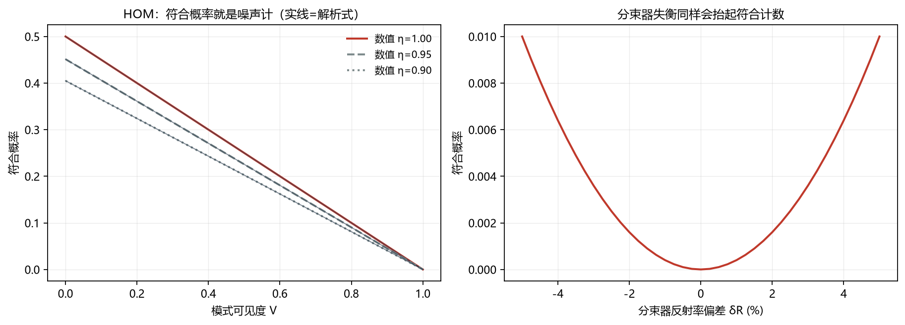
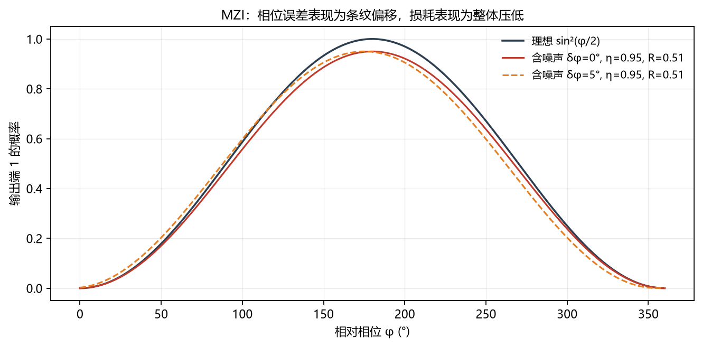
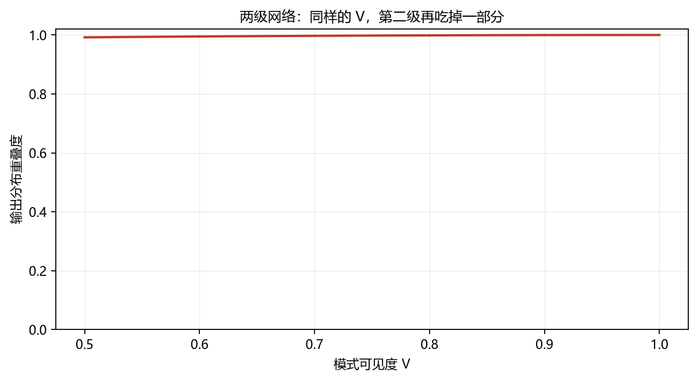
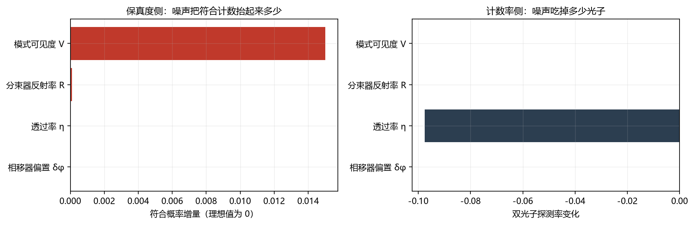

# 光学量子线路的噪声分析（线路层）

> 所有数字由 `analyze.py` 现算生成，不是手填的。
> 全部计算在 Fock 空间精确进行：分束器用 SU(2) 精确矩阵元，损耗用真空端口
> 分束器实现（等价于振幅阻尼，保相干），没有做概率近似。

---

## 1. 摘要

三个线路、四类噪声、一张误差预算表。核心结论：

1. **损耗和模式失配的作用完全不同。** 损耗是乘性的：它被抬高的符合概率按
   $\eta^2$ 缩小，条件保真度基本不动，代价落在计数率上；模式失配是一阶的，
   直接破坏干涉。
2. **HOM 的符合概率本身就是噪声计。** 理想值是 0，任何噪声都会把它抬起来。
   在这个意义上，HOM 不需要额外的噪声表征手段。
3. **保真度和计数率的预算排序完全不同。** 保真度侧排第一的是
   `模式可见度 V`；计数率侧排第一的是
   `透过率 η`。用单一指标做预算，
   会漏掉一半的物理。

## 2. 方法

| 噪声 | 数学实现 | 性质 |
|---|---|---|
| 透过率 η | 与真空端口做 BS，再把辅助模投影回真空 | 精确振幅阻尼，保相位 |
| 模式可见度 V | $\rho = V\rho_{\text{ind}} + (1-V)\rho_{\text{dis}}$ | 对符合概率严格，对保真度是标准近似 |
| 分束比失衡 | 反射率 $0.5+\delta$ 直接进 BS 矩阵 | 酉矩阵偏离 |
| 相位误差 | 相移器偏置 $\delta\phi$ | 条纹偏移 |

状态用占据数字典表示，光子数 ≤ 4、模式数 ≤ 8 时维度很小，全部是精确计算。

## 3. 自检

| 检查项 | 解析式 | 最大偏差 |
|---|---|---|
| HOM 符合概率 | $(1-V)\eta^2/2$ | 1.67e-16 |
| MZI 输出 | $\sin^2(\phi/2)$ | 2.22e-16 |

偏差在数值精度范围内，说明 Fock 演化这一层是对的。
**如果这两行不为零，后面的所有结论都不要信。**

## 4. HOM：符合概率就是噪声计

| 可见度 V | 符合概率 | 聚束概率 |
|---|---|---|
| 1.00 | 0.00000 | 1.00000 |
| 0.99 | 0.00500 | 0.99500 |
| 0.97 | 0.01500 | 0.98500 |
| 0.95 | 0.02500 | 0.97500 |
| 0.90 | 0.05000 | 0.95000 |
| 0.80 | 0.10000 | 0.90000 |

理想情况下两个光子总是从同一侧出来，符合计数严格为 0。可见度掉到 0.97，
符合概率就到 1.5% 量级——这已经足以让后选择门的保真度明显下降。

损耗的影响是乘性的：

| 透过率 η（V=0.97） | 符合概率 | 解析式 (1-V)η²/2 |
|---|---|---|
| 1.00 | 0.01500 | 0.01500 |
| 0.98 | 0.01441 | 0.01441 |
| 0.95 | 0.01354 | 0.01354 |
| 0.90 | 0.01215 | 0.01215 |
| 0.80 | 0.00960 | 0.00960 |

注意符合概率随 η 平方下降，但**这个下降不是保真度下降**，而是成功率下降。
这是后面误差预算那条结论的根据。

## 5. MZI：相位误差 vs 分束比失衡

| 相位偏置 δφ (°) | P0 | 偏离理想值 | 丢失概率 |
|---|---|---|---|
| 0.0 | 0.4752 | -0.0248 | 0.0500 |
| 0.5 | 0.4793 | -0.0250 | 0.0500 |
| 1.0 | 0.4835 | -0.0252 | 0.0500 |
| 2.0 | 0.4918 | -0.0257 | 0.0500 |
| 5.0 | 0.5166 | -0.0270 | 0.0500 |

两种噪声在这里的表现不一样：相位偏置让条纹**平移**，分束比失衡让条纹**变浅**，
损耗让整条曲线**压低**。三者在单条曲线上很难分开，这也是实验上要分别标定的原因。

## 6. 两级网络：噪声会累积

| 可见度 V | 输出分布重叠度 |
|---|---|
| 1.00 | 1.0000 |
| 0.97 | 1.0000 |
| 0.95 | 0.9999 |
| 0.90 | 0.9997 |

同样的可见度，过第二级之后保真度又掉一截。级数越多，对 V 的要求越苛刻——
这就是为什么可扩展的光子线路对源的纯度要求近乎苛刻。

## 7. 误差预算：两列，两种排序

每个噪声源单独恶化到典型实验室水平，其余保持完美：

| 噪声源 | 典型值 | 符合概率增量 | 双光子探测率变化 |
|---|---|---|---|
| 模式可见度 V | 0.97 | +0.01500 | +0.0000 |
| 分束器反射率 R | 0.505 | +0.00010 | +0.0000 |
| 透过率 η | 0.95 | +0.00000 | -0.0975 |
| 相移器偏置 δφ | 0.5 | +0.00000 | +0.0000 |

左图是保真度侧，右图是计数率侧。摆在一起结论就出来了：**可见度只影响保真度，
透过率只影响计数率，两者根本不在同一个轴上**。任何把它们合并成一个数的模型，
都会同时丢掉一半信息。

## 8. 结论

1. **先修 `模式可见度 V`。** 它单独就能把符合概率
   抬得最高；而 `透过率 η` 的影响全落在计数率上，
   两者不能互相抵扣。如果几项同时存在，总量不是简单相加——耦合项要用完整的四参数扫描。
2. **不要把损耗当成退相干。** 在这个模型里，损耗只降低成功率，不降低条件保真度；
   把它折进一个 depolarizing 参数会高估它对保真度的破坏，同时低估它对计数率的破坏。
3. **HOM 可以直接当噪声计用。** 符合概率的抬升量就是噪声的累积效果，
   不需要另做层析。

## 9. 局限

- 可见度用经典混合插值，忽略了部分可分辨态里的相干项；对符合概率严格，对
  多光子线路的保真度是近似。
- 没有建模源的多对发射和探测器暗计数（属于光源/探测层）。
- 没有做到纠错层，所以不能给出"这个损耗水平能不能容错"的结论。
- 第三个线路是两级干涉网络，**不是 CNOT**：后选择 CNOT 需要 NS 门的三分束器
  分解，参数未经验证，本轮不写。

---

*生成：`python analyze.py`*
